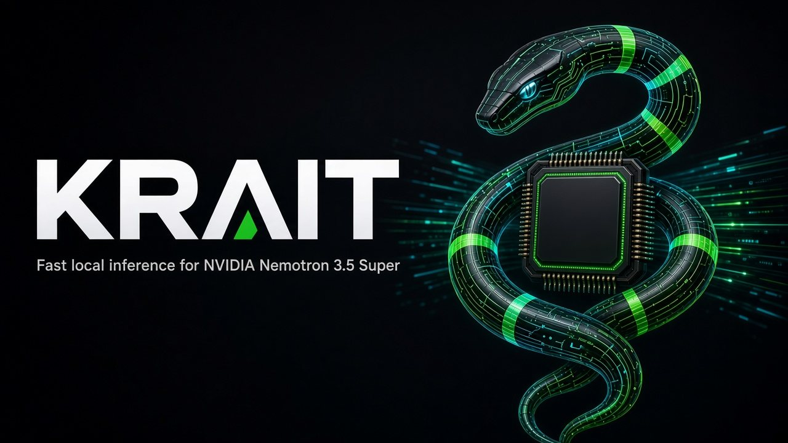
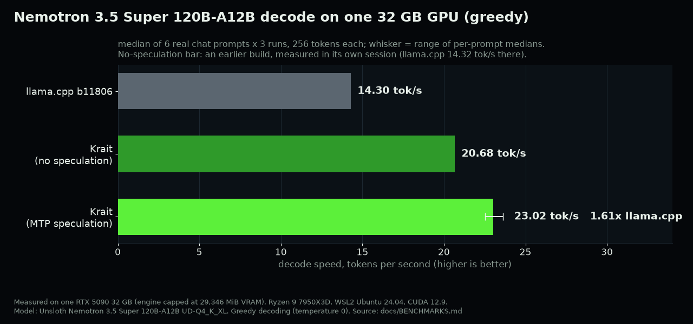
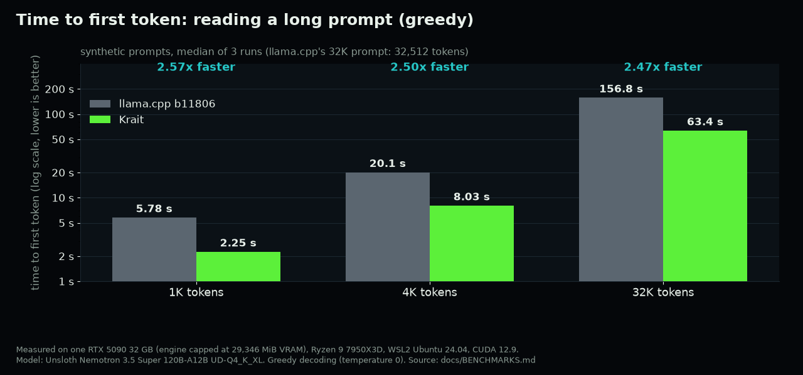
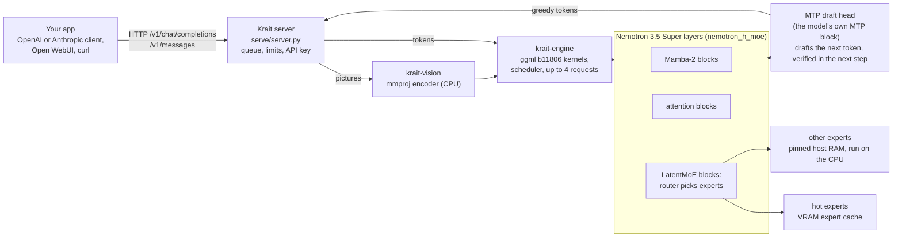

<p align="center">
  
</p>

<h1 align="center">Krait: fast local inference for NVIDIA Nemotron 3.5 Super</h1>

<p align="center"><b>Run Nemotron 3.5 Super 120B locally on one 32 GB GPU such as an RTX 5090: 1.6x llama.cpp's decode speed (greedy), bit-exact.</b></p>

<p align="center">
  <a href="LICENSE"></a>
  <a href="#requirements"></a>
  <a href="https://huggingface.co/nvidia/NVIDIA-Nemotron-3.5-Super-VL-120B-A12B-BF16"></a>
  <a href="#use-it-from-your-apps"></a>
  <a href="#open-webui-and-rag-with-docker"></a>
</p>

**Strata for Nemotron: Krait is a port of [Strata](https://github.com/Niko1221/Strata) (Niko1221/Strata) to NVIDIA
Nemotron 3.5 Super.** It keeps Strata's server, API and vision path and adds an engine of its own for Nemotron's hybrid
Mamba-2 / attention / mixture-of-experts layers.

Krait is a Nemotron 3.5 Super inference engine with an OpenAI-compatible server, for running the model as a local LLM.
It runs **NVIDIA Nemotron 3.5 Super VL 120B-A12B** (GGUF architecture `nemotron_h_moe`, Unsloth's UD-Q4_K_XL GGUF)
on a single 32 GB NVIDIA card such as an RTX 5090, with the routed experts of most layers in host RAM. Its engine,
`krait-engine`, runs on llama.cpp's ggml kernels (b11806) with its own graph, expert cache, scheduler and MTP
speculation. It serves text and pictures over the OpenAI and Anthropic APIs, with up to 4 requests at once.

The model goes by several names. Its official ID is `NVIDIA-Nemotron-3.5-Super-VL-120B-A12B` (NVIDIA publishes it as
[`nvidia/NVIDIA-Nemotron-3.5-Super-VL-120B-A12B-BF16`](https://huggingface.co/nvidia/NVIDIA-Nemotron-3.5-Super-VL-120B-A12B-BF16));
it is also called Nemotron-3.5-Super, Nemotron Super 3.5 VL, Nemotron 3.5 Super 120B or NVIDIA Nemotron Super, and
Ollama lists it as `nemotron-3.5-super`. Its language model uses NVIDIA's Nemotron-H hybrid architecture
(`NemotronHForCausalLM` in Transformers, `nemotron_h_moe` in GGUF). Krait runs Unsloth's GGUF
conversion of that model,
[`unsloth/NVIDIA-Nemotron-3.5-Super-VL-120B-A12B-GGUF`](https://huggingface.co/unsloth/NVIDIA-Nemotron-3.5-Super-VL-120B-A12B-GGUF).

## Why Krait

- **1.6x faster decode than llama.cpp on one 32 GB GPU:** 23.0 tok/s vs 14.3 tok/s on real chat prompts, same machine,
  same expert placement (greedy decoding, see [the caveats](#what-the-numbers-mean)).
- **About 2.5x faster prompt processing:** a 32K-token prompt is read in 63.4 s instead of 156.8 s (2.47x to 2.57x
  across 1K, 4K and 32K prompts).
- **Bit-exact against llama.cpp's reference:** greedy tokens and logits identical to a capture from a reference tool
  built on llama.cpp b11806 on 32 of 32 test prompts (42,075 of 42,075 logits rows, also with speculation on).
- **OpenAI and Anthropic APIs:** `/v1/chat/completions` and `/v1/messages`, streaming, an API key for network use.
- **Vision:** pictures through the model's own projector (`mmproj`), checked token for token against `llama-mtmd-cli`.
- **Open WebUI + RAG Docker stack:** Krait, Open WebUI and a local embedding server for document search, in one
  `docker compose up`.

## Benchmarks: Krait vs llama.cpp on an RTX 5090

<p align="center">
  
</p>
<p align="center">
  
</p>

| greedy, one RTX 5090 | llama.cpp b11806 | Krait |
|---|---|---|
| decode, 6 real chat prompts (median of 18 runs) | 14.30 tok/s | **23.02 tok/s** (1.61x) |
| decode over HTTP, one stream (median of 6) | - | 25.0 tok/s |
| time to first token, 1K / 4K / 32K prompt | 5.780 / 20.103 / 156.849 s | **2.250 / 8.027 / 63.378 s** |
| prompt reading, 1K / 4K / 32K | 177.20 / 203.77 / 207.29 tok/s | 455.04 / 510.25 / 512.99 tok/s |

### What the numbers mean

- **Greedy only.** Every speed above is greedy decoding (temperature 0). MTP speculation is used only for greedy
  requests decoded alone; sampled requests and `--batch` slots decode without it, and sampled speed was not measured.
  Without speculation an earlier Krait build measured 20.68 tok/s (llama.cpp: 14.32 in that session).
- **One machine.** RTX 5090 32 GB with the engine capped at 29,346 MiB of VRAM, Ryzen 9 7950X3D (16 threads), WSL2
  Ubuntu 24.04 with 116,713 MiB of RAM visible, CUDA 12.9. Other hardware is untested. Treat these as one data point.
- **Exactness is against the golden capture, not `llama-server`.** Against `llama-server` b11806 the greedy text on 6
  real prompts drifts apart after 40 to 197 tokens.
- Methods, memory figures and every raw number: [docs/BENCHMARKS.md](docs/BENCHMARKS.md).

## How it works: a Mamba MoE inference engine



The GPU holds the rest of the weights and a cache of the most-used experts. The routed experts of 68 layers
(`--n-cpu-moe 68`) live in page-locked host RAM; the CPU reads those that are not in the cache. More details:
[docs/KRAIT.md](docs/KRAIT.md).

## Requirements

- **GPU:** an NVIDIA GPU with 32 GB of VRAM (tested: RTX 5090, sm_120 only) and a CUDA toolkit that supports it (sm_120
  needs CUDA 12.8 or newer; tested with 12.9). The engine refuses to start, and says why, if its expert cache does not
  fit; cards with less VRAM are untested.
- **Host RAM:** the engine keeps the routed experts of 68 layers in RAM. Measured: engine resident set 81.3-81.8 GiB, of
  which `--pin` page-locks 72,261.3 MiB; tested only with 116,713 MiB of RAM visible to Linux. Before pinning, the
  engine checks the RAM available to it and locks only what fits while leaving `--pin-reserve-mib` (default 8,192 MiB)
  free; if not everything fits it says so and runs with the rest unpinned (slower).
- **WSL2:** the WSL VM gets only part of the Windows RAM by default (half). Give it more in `%UserProfile%\.wslconfig`,
  for example `[wsl2]` / `memory=116GB` on a 128 GB PC, then `wsl --shutdown` once. (Docker Desktop has its own memory
  setting.)
- **Software:** Linux or WSL2 with a CUDA toolkit (nvcc), cmake >= 3.21, ninja, gcc/g++, curl, and Python 3.10+ with
  venv.
- **Model (not included):** Unsloth's GGUF of NVIDIA-Nemotron-3.5-Super-VL-120B-A12B, `UD-Q4_K_XL` (3 shards), plus
  `mmproj-BF16.gguf`.

## Quick start

```bash
git clone https://github.com/bobathefetts/krait && cd krait
python3 -m venv .venv && .venv/bin/pip install -r requirements.txt
krait/build.sh     # fetches llama.cpp b11806 + the pinned commit; builds krait-engine, krait-layout, krait-vision
                   # (CUDA_ARCH=120 by default; set it for another card - untested)

# the model (not included): huggingface.co/unsloth/NVIDIA-Nemotron-3.5-Super-VL-120B-A12B-GGUF, laid out as
#   $KRAIT_MODELS/UD-Q4_K_XL/NVIDIA-Nemotron-3.5-Super-VL-120B-A12B-UD-Q4_K_XL-0000{1,2,3}-of-00003.gguf
#   $KRAIT_MODELS/mmproj-BF16.gguf
export KRAIT_MODELS=/path/to/models

# the tokenizer pack (written to pack/nemotron/tokenizer/)
.venv/bin/python3 tools/strata_tokenizer.py \
  --gguf "$KRAIT_MODELS/UD-Q4_K_XL/NVIDIA-Nemotron-3.5-Super-VL-120B-A12B-UD-Q4_K_XL-00001-of-00003.gguf" \
  --out pack/nemotron

krait/krait        # http://127.0.0.1:8095/v1 (OpenAI) and /v1/messages (Anthropic)
```

`krait/krait` checks the install first and names whatever is missing (Python packages, binaries, model files, the
tokenizer pack). Its settings are environment variables listed at the top of `krait/krait` (`KRAIT_ROOT`,
`KRAIT_MODELS`, `KRAIT_PYTHON`, `KRAIT_THREADS`, `KRAIT_ENGINE_ARGS`, ...). Engine flags that belong to one machine,
such as a VRAM cap on a card that also drives a desktop, go in `krait.local.json` (see
`krait/krait.local.example.json`; git ignores the copy).

### Use it from your apps

```bash
curl http://127.0.0.1:8095/v1/chat/completions -H 'Content-Type: application/json' \
  -d '{"messages":[{"role":"user","content":"Say hello."}],"max_tokens":64}'
```

Any OpenAI-compatible client works with base URL `http://127.0.0.1:8095/v1`; Anthropic clients use
`http://127.0.0.1:8095` (they add `/v1/messages` themselves).

On the network: `KRAIT_API_KEY=<long random key> HOST=0.0.0.0 krait/krait`. Krait refuses a non-loopback HOST without
a key, and refuses placeholder keys (`change-me...`).

Pictures: by default the server accepts pictures only inline as `data:` URLs. `KRAIT_IMAGE_FILES=1` allows local file
paths, `KRAIT_IMAGE_URLS=1` allows downloads from public http(s) addresses (private, loopback and link-local addresses
are refused, also after a redirect).

### Open WebUI and RAG with Docker

Docker Engine + NVIDIA Container Toolkit:

```bash
cp docker/krait/env.example docker/krait/.env     # set KRAIT_MODELS and the keys
docker/krait/stage.sh                              # builds krait:local from your build
docker compose -f docker/krait/compose.yml up -d   # Open WebUI on http://127.0.0.1:3095
```

The image contains your build's binaries. `krait/build.sh` builds for the CPU it runs on by default
(`KRAIT_NATIVE=1`), so the image may not run on a machine with an older CPU; `KRAIT_NATIVE=0` builds generic x86-64
code (untested).

### `--prefix-reuse`

The shipped config (`krait/config.json`) uses `--prefix-reuse off`: every request reads its whole prompt, so served
greedy output equals the CLI token for token. `--prefix-reuse on` keeps a conversation's state between turns and reads
only the new tokens. Follow-ups are faster, but the output is not bit-identical to a fresh read (measured: 4 of 6 second
turns differed; with `off`, 12/12 identical). Sessions that hold a picture are never reused.

## Coming from Strata?

Krait is Strata's server and tooling with a Nemotron engine in place of Strata's Qwen engine. What carries over, and
what is called something else:

| in Strata | in Krait |
|---|---|
| model: Qwen3.8-Flash-Next (Strata packs) | model: Nemotron 3.5 Super VL 120B-A12B, Unsloth's UD-Q4_K_XL GGUF as is, plus a tokenizer pack from `tools/strata_tokenizer.py` |
| the app, `START-HERE.bat`, `setup.sh`, `strata launch` | `krait/build.sh` to build, `krait/krait` to run (Linux / WSL2, from source) |
| Strata's engine | `krait-engine` (src/nemotron_h/), on llama.cpp b11806's ggml |
| `http://127.0.0.1:8080/v1` | `http://127.0.0.1:8095/v1` (`PORT` to change it) |
| `STRATA_API_KEY` / `"api_key"` | `KRAIT_API_KEY` (passed on to the same server as `STRATA_API_KEY`) |
| `--expert-cache N` / `auto` (VRAM expert cache) | `--cache all`, sized from `--vram-limit-mib` or the free VRAM minus `--vram-reserve-mib` |
| `--vram-reserve-mib` | `--vram-reserve-mib` (default 2,048) or a hard cap with `--vram-limit-mib` |
| experts in RAM / `--mmap-experts` | `--n-cpu-moe 68` (routed experts of 68 layers in RAM) + `--pin` (page-locked), `--pin-reserve-mib` |
| `--spec N --mtp` | `--spec mtp --spec-k 1 --spec-min-acc 0.6` (the model's own MTP block; greedy requests only) |
| `--batch` | `--batch 2..4` (rows mode, no MTP in batch slots) |
| `--max-context` / `--context` | `--max-context 32768` |
| `--prompt-cache` (conversation reuse) | `--prefix-reuse on\|off` (off by default, so output stays bit-exact) |
| `--vision` (`strata-vision`) | the `vision` section of `krait/config.json` (`krait-vision`, the same encoder, on the CPU) |
| `strata-<model>.json` | `krait/config.json` + your own `krait.local.json` |

The rest of Strata (its Qwen engine, the app and tools) is still in this repository; Strata's README is
[STRATA_README.md](STRATA_README.md). The Nemotron changes to the shared server and vision encoder are listed in
[docs/KRAIT.md](docs/KRAIT.md).

## FAQ

**Is this Strata Nemotron, or a fork of Strata?** Both: it is a fork of Strata v0.2.2 that adds a Nemotron 3.5 Super
engine. If you searched for "Strata Nemotron", this is it. Strata itself runs Qwen models; Krait runs Nemotron.

**How is Krait different from other Nemotron ports of Strata?** Krait runs the standard Unsloth GGUF (UD-Q4_K_XL) with
llama.cpp's numerics: with greedy decoding its output is token-identical to a llama.cpp b11806 reference capture on all
32 prompts of the golden set. It does not depend on Blackwell FP4 / NVFP4 kernels, and its speed figures are measured
against llama.cpp on the same machine ([docs/BENCHMARKS.md](docs/BENCHMARKS.md)). If you own a Blackwell card and want
FP4, there are NVFP4-based forks too, for example the
[`strata-nemotron` branch of Cudila/Strata](https://github.com/Cudila/Strata/tree/strata-nemotron), which targets
NVFP4 weights on FP4 tensor cores.

**Does it run other Nemotron models (Nemotron 3 Super, Nemotron 3.5 Lightning, Nano)?** Krait was built and tested
only for Nemotron 3.5 Super VL 120B-A12B (UD-Q4_K_XL). Other Nemotron models and other quantizations are untested;
`krait-layout` checks a GGUF's tensors before the engine uses it.

**Can I run Nemotron 120B locally?** Yes, on one 32 GB NVIDIA GPU with enough host RAM for the engine (measured
resident set 81.3-81.8 GiB; tested with 116,713 MiB visible to Linux). Smaller cards and less RAM are untested.

**Is Krait a Nemotron llama.cpp alternative?** For Nemotron 3.5 Super on this kind of machine, yes: it uses
llama.cpp's ggml kernels but its own Mamba MoE inference engine, and on the tested machine it decoded 1.61x and read
prompts about 2.5x faster than llama.cpp b11806 with the same expert placement. Output is bit-identical to a llama.cpp
b11806 reference capture with greedy decoding; it is not token-identical to `llama-server`.

**Does it work on an RTX 4090 / 3090 (24 GB) or a 5080?** Untested. The engine sizes its expert cache from the VRAM it
may use and refuses to start, saying why, if the cache does not fit.

**Is the speed the same with temperature > 0?** Not measured. Sampled requests decode without MTP speculation, so
expect them to be slower than the greedy figures.

**Windows?** Through WSL2; that is the only way it was tested.

**Is it open to the network?** Not by default: the server listens on 127.0.0.1, accepts pictures only as inline
`data:` URLs, and refuses a non-loopback `HOST` without an API key.

## More

- Build, flags, server limits, correctness checks, Docker and tests: [docs/KRAIT.md](docs/KRAIT.md).
- Measured numbers: [docs/BENCHMARKS.md](docs/BENCHMARKS.md).
- Names (binaries, image, environment) live in `krait/project.env`.
- Tests: `cmake -DSTRATA_BUILD_TESTS=ON ...` then `ctest -R "nemotron|nh_"` (no model needed).
- Third-party licenses, including the model's: [THIRD_PARTY_NOTICES.md](THIRD_PARTY_NOTICES.md).
- README images: `docs/assets/` (`docs/assets/make_assets.py` redraws the charts from the numbers in
  docs/BENCHMARKS.md).

## Credits

- **[Strata](https://github.com/Niko1221/Strata)** by Niko1221 and the Strata contributors (MIT): the server, the API,
  the vision path, the tooling and much of the know-how Krait builds on.
- **[llama.cpp](https://github.com/ggml-org/llama.cpp)** and ggml (MIT): the kernels, the model loader and the
  reference that Krait's output is checked against.
- **NVIDIA** for the Nemotron 3.5 Super weights (OpenMDW-1.1) and **Unsloth** for the GGUF conversion.
- **Open WebUI** and the other projects in the Docker stack; see [THIRD_PARTY_NOTICES.md](THIRD_PARTY_NOTICES.md).

## License

MIT ([LICENSE](LICENSE)). Krait is based on Strata by Niko1221 (MIT), Copyright (c) 2026 Niko1221 and the Strata
contributors. The model weights are not part of Krait and have their own license (OpenMDW-1.1, see
THIRD_PARTY_NOTICES.md).

NVIDIA and Nemotron are trademarks of NVIDIA Corporation. Krait is an independent project and is not affiliated with,
endorsed by or sponsored by NVIDIA. RTX is a trademark of NVIDIA; other names belong to their owners.
